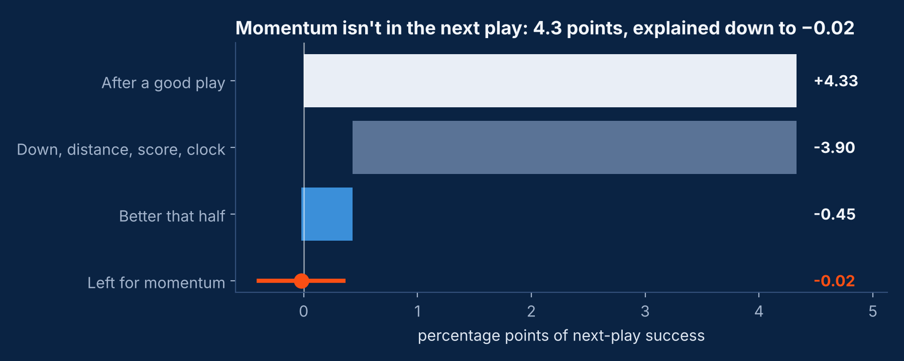

# Can you find momentum?

An entry for The Side Quest's momentum challenge, by Raahul Narayanan, MPH.

**Answer.** We tested 1.7 million NFL and college plays with every control the challenge asked for. Two things get called momentum. Field momentum, a good play leaving you a better down and spot, is real and explains almost all of the "success follows success" pattern. Felt momentum, success feeding itself beyond the spot, isn't in the next play or the next drive. A successful play is followed by a successful play 4.3 percentage points more often than a failed one (2019–2025, tested only after the rules were committed). The situation it leaves you in explains 3.9 points, who was better that half explains 0.45, and what's left for momentum is **−0.02 (95% range −0.41 to +0.37)**. Our test catches planted momentum of 0.5 points 80% of the time, so this is a measured zero, not a blind spot.



## What we found

| Test (pre-registered) | NFL 2019–25 | NFL 1999–2018 | College 2019–21 |
|---|---|---|---|
| P1 play → next play, pts | −0.02 (p .90) | −0.04 | −0.60, Holm p .002, the wrong way |
| P2 drive → our next drive, pts per pt | +0.006 (p .24) | +0.002 | +0.007 (p .12) |
| P3 our drive → their next drive, pts per pt (momentum predicts < 0) | +0.008 (p .22) | +0.001 | −0.016, Holm p .02 |
| P4 fumble bounce, next-possession swing, pts | +0.37 (p .04, Holm .18) | −0.04 | −0.12 (balance fails) |

- **Nothing in the NFL survives correction.** Secondary tests also come back empty: next play after a 4th-down conversion, high-stakes vs low-stakes snaps, home vs away offense, 2020 empty stadiums, halftime. The one hint, fumble bounces in the holdout, wasn't there in the 20-season discovery set, and 2026 to date points the other way.
- **College is the one place something shows up, and it's tiny.** Drives carry slightly into the same offense's next drive within a half (+0.015 successful plays per extra successful play, p .002, replicated from 2014–2018 on this secondary yardstick), and it flips negative across halftime, which looks like coaching adjustments more than a feeling. College play-to-play runs slightly *anti*-momentum, which may be ball-spot recording error.
- **No team or quarterback plays with momentum.** 6.3% of 893 team-seasons fall outside the chance funnel (5% expected), and a team's index predicts next year's at r = 0.10.
- **The Broncos are 17–1 in one-score games since October 2025.** With close-game-calibrated odds they'd expect about 10 wins; 17–1 or better happens in 1 of about 3,300 fair replays, matched since 1999 only by the 2002–04 Patriots and the 2023–25 Chiefs. Close-game luck has a year-to-year correlation of −0.003, and the 2025 Broncos' in-game momentum index ranks 434th of 893, dead average.

- **We tried to break it** (`src/stress.py`, run after the locked tests, all 28 NFL seasons): bare-bones controls with a whole-game shuffle (−0.06), EPA instead of success, live games only, streaks of 2 and 3, after big plays, passes vs runs. None move off zero. Splitting the 4.3 points: down/distance/field/play type 3.87, score/clock/team strength 0.03, better that half 0.45, order −0.02.
- **Forced pauses don't drain anything.** Within a drive, carryover is +0.07 pts with no pause, −0.36 across a clock-forced quarter break and +0.18 across a defensive timeout, all noise. After two straight successes, a defensive timeout is followed by a play 1.3 pts below expectation (95% range −4.2 to +1.9, 930 timeouts).

Interactive version: `docs/index.html` (serve the folder; it reads `docs/data.json`).

## How it works

1. **Score every play against its situation.** A gradient-boosted model predicts each snap's chance of success (EPA > 0) from down, distance, field, clock, score, timeouts, first play of the drive, pass or run, the spread and total, and each team's form from earlier games. It never sees earlier plays from the same game, and each season is predicted by a model trained without it. This is the football version of controlling for shot difficulty (Bocskocsky, Ezekowitz & Stein 2014).
2. **Hold "better that day" fixed, test order.** Write the residual sequence as r_t = α + ρ·r_{t−1} + ε. α is a good day, ρ is momentum. We shuffle each offense's plays within each half 2,000 times. The shuffle keeps α in the baseline and also carries the finite-sequence streak-selection bias (Miller & Sanjurjo 2018) into the baseline, so it cancels.
3. **Drives as sums.** Per-drive *averages* of residuals are biased by drive length (our first fumble result, p < .001, was this artifact). Sums of residuals have mean zero under no momentum whatever the length, so drives use points over expected and summed residuals. Drive tests shuffle whole drives and control for the last drive's length (defensive fatigue). Cross-unit tests use Freedman–Lane permutation.
4. **Natural experiment.** Fumble recovery is close to random within fumble type. We compare bounces to the defense vs to the offense within type × forced strata, with randomization inference, and check that pre-fumble form doesn't predict the bounce (p = .37 and .95 in 2019–2025).
5. **Pre-registration.** Everything was built on NFL 1999–2018 and college 2014–2018. `PREREG.md` was committed (see `git log`) before any test touched 2019–2025. Four primary tests per league share a Holm correction.
6. **Test the test.** `src/simulate.py` builds fake seasons on the real situations. No momentum: 3 of 30 flagged. Planted +0.5 / +1 / +2 points: caught 80% / 100% / 100%, estimated 0.47 / 0.92 / 1.80. Mid-half level shifts (injury-style drift) can fake a positive, which is why P3 and P4 exist.

## Run it

```bash
pip install -r requirements.txt
./run_all.sh      # downloads nflverse + cfbfastR data, builds tables, fits models, runs every test
jupyter notebook notebooks/momentum.ipynb
```

Runtime is about 25 minutes on a laptop. Results land in `results/`, figures in `figures/`.

| Path | What it does |
|---|---|
| `src/build_nfl.py`, `src/build_cfb.py` | Clean play, drive and fumble tables. College plays are re-ordered by ESPN sequence number (many files are stored newest-first) and duplicate snaps removed. |
| `src/models.py` | Cross-fitted expected-success, expected-EPA, expected-drive-points and pre-snap-stakes models |
| `src/perm.py` | Within-block shuffle tests, Freedman–Lane, Holm |
| `src/analysis.py` | Every hypothesis test |
| `src/run_confirmatory.py` | Runs one league × split, writes `results/*.json` |
| `src/simulate.py` | Planted-momentum validation |
| `src/stress.py` | Post-hoc robustness, decomposition, quarter-break and timeout pauses |
| `src/exploratory.py` | Team and QB momentum index, Broncos close games, game timelines |
| `src/build_page_data.py` | Builds `docs/data.json` from results for the interactive page |

## Limits

- A positive play-to-play result could come from slow drift inside a half. The NFL result is zero, so drift isn't hiding anything, but it's why the drive, cross-unit and fumble tests exist.
- College data lacks aborted-snap and out-of-bounds fumble flags, so college fumble recovery fails balance and college P4 isn't a natural experiment.
- The college anti-momentum result could be spot-recording error. A spot-free outcome (completion on consecutive passes) is the natural next check.
- This tests outcomes. Coaches clearly change decisions after big moments, as the video showed; that is real and separate.

## Sources

- nflverse play-by-play (the data behind nflfastR): https://github.com/nflverse/nflverse-data. College: https://github.com/sportsdataverse/cfbfastR-data. Brian Burke's 2002–2012 files and the Kaggle 2017–2023 scores are subsets of nflverse.
- Gilovich, Vallone & Tversky (1985). The hot hand in basketball. *Cognitive Psychology* 17.
- Miller & Sanjurjo (2018). Surprised by the hot hand fallacy? *Econometrica* 86(6). https://doi.org/10.3982/ECTA14943
- Bocskocsky, Ezekowitz & Stein (2014). Heat check: new evidence on the hot hand in basketball. https://ssrn.com/abstract=2481494
- Fry & Shukairy (2012). Searching for momentum in the NFL. *Journal of Quantitative Analysis in Sports* 8.
- Roebber, Burlingame & deWinter (2022). On the existence of momentum in professional football. *PLOS ONE* 17(6). Rebuilt in The Side Quest explainer: https://thesidequest.com/posts/momentum-lab/
- Adler (1981); Markman & Guenther (2007): psychological momentum as velocity × mass, the reason for the high-stakes test.
- Freedman & Lane (1983). *Journal of Business & Economic Statistics* 1(4). Nickell (1981). *Econometrica* 49(6).
- Fumble recovery as luck: https://footballperspective.com/2013-fumble-recovery-data-has-jets-cowboys-at-extremes
- Ehrlich, Potter & Sanders (2021). The effect of attendance on home field advantage in the NFL: a natural experiment. https://core.ac.uk/download/387554353.pdf
- Stern (1991). On the probability of winning a football game. *The American Statistician* 45(3).
